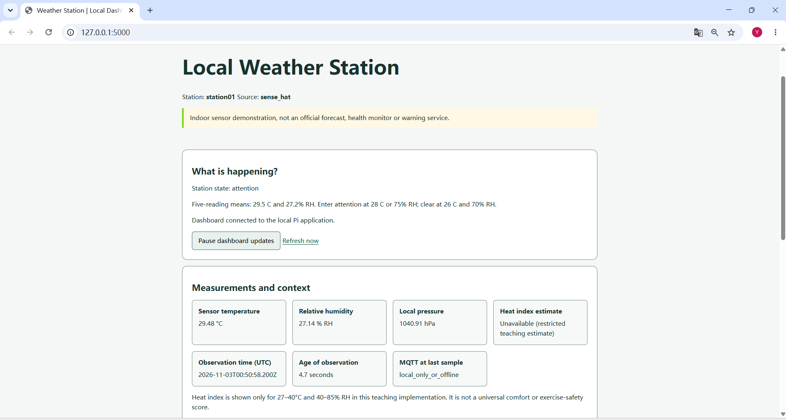
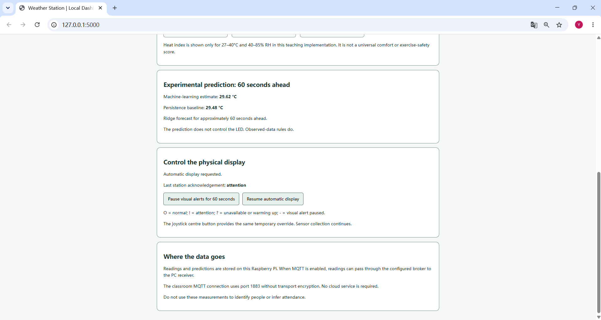

# AI at the Edge – Weather Station Workbook

**Raspberry Pi 4 | Sense HAT | MQTT | Ridge Regression | Flask | SQLite**

A seven-week practical project developed for the **AI at the Edge** module in the MSc Applied Artificial Intelligence programme at South East Technological University (SETU), Ireland.

The project explores how a small edge device can collect environmental measurements, interpret context, run a lightweight machine learning model, communicate with another computer and provide a usable local interface.

Rather than relying on a cloud service, the Raspberry Pi performs sensing, data storage, contextual reasoning and model inference locally.

## Dashboard Preview

The following screenshots show the actual local Flask dashboard running with Sense HAT observations. The first shows the measurements and contextual explanation; the second shows the experimental forecast and LED controls.





## 1. Project Overview

The weather station uses a Raspberry Pi 4 with a Sense HAT to collect three environmental measurements:

- Temperature (°C)
- Relative humidity (% RH)
- Atmospheric pressure (hPa)

Readings are collected approximately every five seconds and stored in a local SQLite database.

The system uses a five-reading window to identify environmental conditions and a Ridge Regression model to predict sensor temperature approximately 60 seconds ahead.

A Flask dashboard displays the latest measurements, context explanations, experimental predictions and physical LED display controls.

An MQTT connection also allows observations to be transmitted to a Windows PC for separate storage and model development.

### System Architecture

```text
                   Raspberry Pi 4 + Sense HAT
                              |
                              v
                       Sensor Collection
                         (station.py)
                              |
                +-------------+-------------+
                |                           |
                v                           v
         SQLite Storage              MQTT Publisher
         (weather.db)                      |
                |                           v
                |                    Mosquitto Broker
                |                           |
                |                           v
                |                    Windows PC Receiver
                |                           |
                |                           v
                |                    Central SQLite DB
                |
                v
       Five-Reading Feature Window
                |
         +------+------+
         |             |
         v             v
    Context Rules   Ridge Regression
         |          60-second Forecast
         |             |
         v             v
    Sense HAT LED   Flask Dashboard
    Status Display  and Explanations
```

The system separates data collection, model inference, communication and user interaction. Local sensing and storage can continue when the MQTT network or Windows receiver is unavailable.

## 2. Repository Structure

The repository contains two connected project components.

```text
AI-at-the-Edge/
|
+-- weather-station-pi/
|   +-- station.py
|   +-- sensors.py
|   +-- storage.py
|   +-- features.py
|   +-- context.py
|   +-- model_runtime.py
|   +-- mqtt_link.py
|   +-- matrix.py
|   +-- webapp.py
|   +-- benchmark.py
|   +-- templates/
|   +-- static/
|   +-- tests/
|   +-- models/
|   +-- data/
|   +-- docs/
|   +-- README.md
|
+-- weather-station-pc/
|   +-- central_receiver.py
|   +-- check_training_data.py
|   +-- train_model.py
|   +-- model_runtime.py
|   +-- features.py
|   +-- data/
|   +-- models/
|   +-- docs/
|   +-- README.md
|
+-- .gitignore
+-- README.md
```

**Raspberry Pi component:** Real-time sensing, local storage, contextual reasoning, deployed inference, MQTT publishing, LED feedback and the Flask dashboard.

**Windows PC component:** MQTT reception, training data inspection, chronological model evaluation and Ridge model export.

Each component has its own README with more detailed implementation and setup instructions.

## 3. Development Journey

The workbook was completed progressively across seven practical stages.

| Week | Focus | Main Work |
|---|---|---|
| 1 | Environment setup | Raspberry Pi configuration, Python environment and initial project structure |
| 2 | Sensing and storage | Sense HAT measurements, data validation and SQLite persistence |
| 3 | Communication | Mosquitto, MQTT publishing, Windows PC receiver and network failure testing |
| 4 | Context awareness | Five-reading feature window, environmental state rules and hysteresis |
| 5 | Edge intelligence | Ridge Regression training, chronological evaluation, deployment and benchmarking |
| 6 | Interaction | Flask dashboard, Sense HAT LED feedback, display controls and accessibility checks |
| 7 | Responsible use | Data lifecycle, privacy, retention, security risks and evidence-based reflection |

Weekly learning journals are available in `weather-station-pi/docs/`.

## 4. Context-Aware Behaviour

The station calculates contextual information from five consecutive valid sensor readings.

The feature window includes current measurements, five-reading temperature and humidity averages, and temperature change across the window.

A rule-based policy classifies the environmental state as:

- `normal` – conditions are within the configured range.
- `attention` – temperature or humidity reaches an attention threshold.
- `warming_up` – insufficient continuous valid readings are available.
- `unknown` – readings are invalid or cannot be interpreted reliably.

Hysteresis uses separate entry and clearing thresholds to reduce unnecessary switching between normal and attention states.

The policy operates independently of the machine learning forecast. Predictions do not directly control LED alerts.

## 5. Machine Learning Experiment

### Objective

Predict the Sense HAT temperature approximately 60 seconds ahead using recent environmental observations.

### Dataset

The recorded training database contained **972 real Sense HAT observations**, with 971 valid readings.

The sampling interval was approximately five seconds.

A continuity check identified seven continuous segments and 920 potentially usable 60-second prediction examples before chronological partitioning.

### Modelling Approach

The experiment compared:

1. **Persistence baseline:** Use the current temperature as the future prediction.
2. **Ridge Regression:** Estimate future temperature using six features derived from a five-reading observation window.

The data was divided chronologically into training, validation and test partitions.

Feature scaling was fitted using the training partition only, and the Ridge regularisation parameter was selected using validation performance.

### Held-Out Test Results

| Model | MAE (°C) | RMSE (°C) |
|---|---:|---:|
| Persistence baseline | 0.1012 | 0.1275 |
| Ridge Regression | **0.0900** | **0.1122** |

The selected Ridge parameter was `alpha = 0.01`.

Ridge achieved lower MAE and RMSE than persistence on this particular held-out test partition.

However, the improvement should not be interpreted as evidence of general performance across different devices or environments.

### Edge Deployment

The trained model was exported to JSON and loaded on the Raspberry Pi using a lightweight Python implementation.

The inference runtime checks observation validity, feature compatibility and data provenance before producing a forecast.

When the input is unsuitable, the model can abstain instead of returning an unsupported prediction.

Forecasting runs in *shadow mode*: predictions are displayed and recorded but do not replace the observed-data context policy.

## 6. Raspberry Pi Performance

Three separate benchmarks were completed on the Raspberry Pi, each with 1,000 inference iterations.

| Run | Median Inference Time | 95th Percentile |
|---|---:|---:|
| 1 | 0.014778 ms | 0.015372 ms |
| 2 | 0.014528 ms | 0.015020 ms |
| 3 | 0.014500 ms | 0.015074 ms |

These measurements demonstrate that the exported Ridge model can execute with low inference latency on the tested Raspberry Pi.

**Measurement boundary:** The benchmarks time model inference with representative synthetic inputs. They do not include sensor acquisition, SQLite writes, MQTT transmission, dashboard rendering or electrical power consumption.

Supporting benchmark records and runtime measurements are stored in `weather-station-pi/docs/evidence/week-05/`.

## 7. Local Dashboard and Physical Interaction

A Flask dashboard was developed to make the station understandable without reading raw JSON observations.

The interface includes:

- Live temperature, humidity and pressure readings.
- Environmental context and explanations.
- Observation age and stale-data handling.
- Experimental Ridge prediction and persistence baseline.
- Browser update pause and refresh controls.
- Temporary Sense HAT visual alert muting.
- Physical display acknowledgement and information about data handling.

The browser update pause and LED alert pause are deliberately separate. Neither is intended to stop sensor collection.

Only the station process controls the Sense HAT hardware directly.

The interface was checked using keyboard navigation, 200% browser zoom and narrow-screen layouts.

Real interface screenshots and design notes are available in `weather-station-pi/docs/evidence/week-06/`.

## 8. Installation and Running the Project

**Before running either component, create a Python virtual environment and install its required dependencies.** Virtual environments are intentionally not included in this repository. Follow the setup instructions in [Raspberry Pi README](weather-station-pi/README.md) and [Windows PC README](weather-station-pc/README.md) before using the commands below.

### Raspberry Pi

Hardware:

- Raspberry Pi 4
- Sense HAT
- Raspberry Pi OS
- Python 3.13 environment

From the Raspberry Pi project directory:

```bash
cd weather-station-pi
source .venv/bin/activate
```

If setting up a new environment, follow the detailed instructions in `weather-station-pi/README.md`.

Run the station with the deployed model:

```bash
python station.py --no-mqtt --model models/temperature_model.json
```

For a short eight-reading test:

```bash
python station.py --no-mqtt --model models/temperature_model.json --samples 8
```

Launch the dashboard in another terminal:

```bash
python webapp.py
```

The local dashboard is available at:

`http://127.0.0.1:5000`

When using VS Code Remote-SSH, the dashboard can be accessed through port forwarding.

### Windows PC

The Windows component was developed using Python 3.12.

Install its training dependencies:

```bash
python -m pip install -r requirements-training.txt
```

Inspect the recorded dataset:

```bash
python check_training_data.py
```

Train and evaluate the Ridge model:

```bash
python train_model.py
```

For MQTT reception, configure the broker address in `config_pc.json` and run:

```bash
python central_receiver.py --config config_pc.json
```

The MQTT broker and station publisher must be running for live reception.

The classroom MQTT configuration is anonymous and unencrypted. It should only be used on a controlled, trusted network.

Refer to `weather-station-pc/README.md` for detailed instructions.

## 9. Testing and Evidence

The Raspberry Pi application completed **25 automated unit tests**, covering:

- Observation schema and data quality.
- SQLite storage and deduplication.
- Feature windows and continuity.
- Context-state hysteresis.
- Invalid and incompatible model inputs.
- Flask dashboard status and web control validation.

Run the Pi test suite with:

```bash
python -m unittest discover -s tests -v
```

Additional practical checks covered MQTT interruption, local data persistence, dashboard freshness, visual display controls and retained-message cleanup.

The evidence index is available at:

`weather-station-pi/docs/evidence/README.md`

It includes structured benchmark results, model evaluation records, interface screenshots and cleanup test notes.

## 10. Privacy, Security and Limitations

This is an **educational indoor environmental monitoring prototype**, not a certified weather instrument, health monitor or safety warning system.

Important limitations include:

- **Sensor heating:** Sense HAT temperature may be influenced by the Raspberry Pi itself.
- **Limited training conditions:** The model was trained on one device over a relatively short observation period.
- **Network security:** The classroom MQTT setup used anonymous, unencrypted communication.
- **Prediction uncertainty:** Low test MAE does not guarantee reliable operation in unfamiliar conditions.
- **Benchmark scope:** Fast inference alone does not establish low end-to-end latency or low electrical power consumption.
- **Data retention:** SQLite databases, exported files and model development copies require separate retention decisions.
- **Accessibility:** Manual interface checks do not establish full accessibility compliance.

The project documents these concerns rather than treating successful code execution as proof of production readiness.

More detailed discussion is available in:

- `weather-station-pi/docs/model-card.md`
- `weather-station-pi/docs/benchmark.md`
- `weather-station-pi/docs/data-flow.md`
- `weather-station-pi/docs/lesi-review.md`
- `weather-station-pi/docs/privacy-notice.md`
- `weather-station-pi/docs/final-review.md`

## 11. Reflection

The main outcome of this workbook was understanding how the different parts of an edge AI system work together.

Sensor measurements need validation and appropriate storage before they can support reliable decisions. Network communication introduces additional failure modes, while machine learning models require careful evaluation and clear deployment limits.

Building the local dashboard also showed the importance of presenting information in a form that users can understand, rather than simply exposing technical outputs.

The project reinforced that an edge system should be evaluated not only by whether it works under normal conditions, but also by how it behaves when data is missing, the network fails or a prediction cannot be justified.
